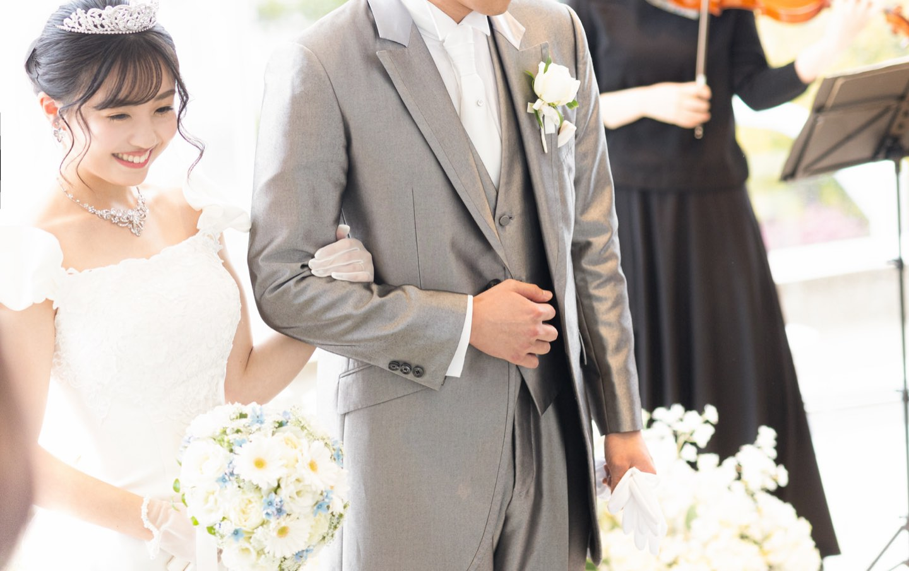
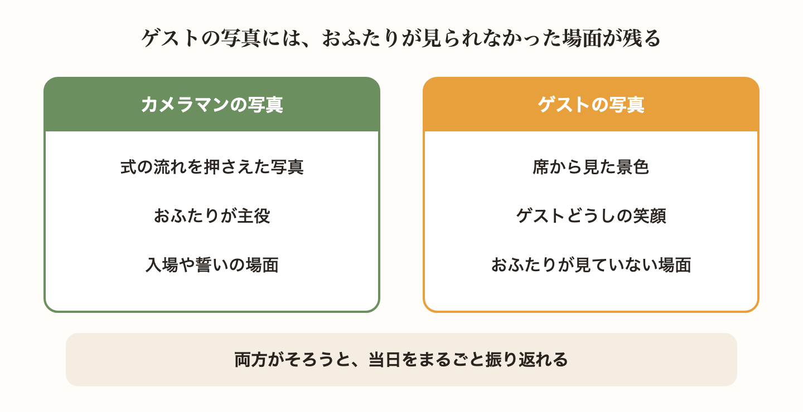
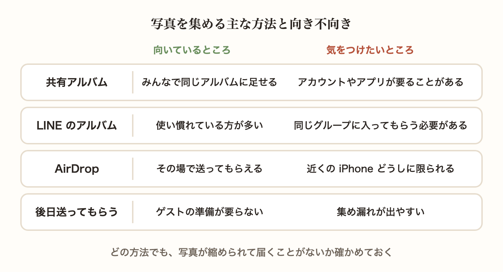
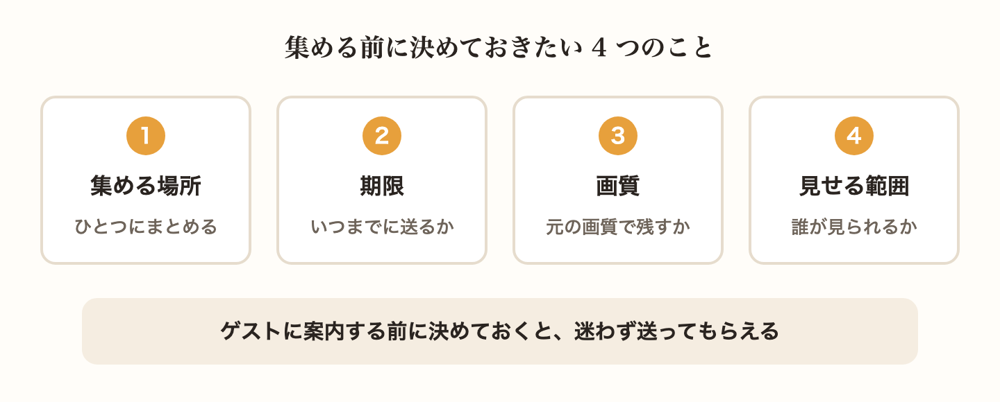
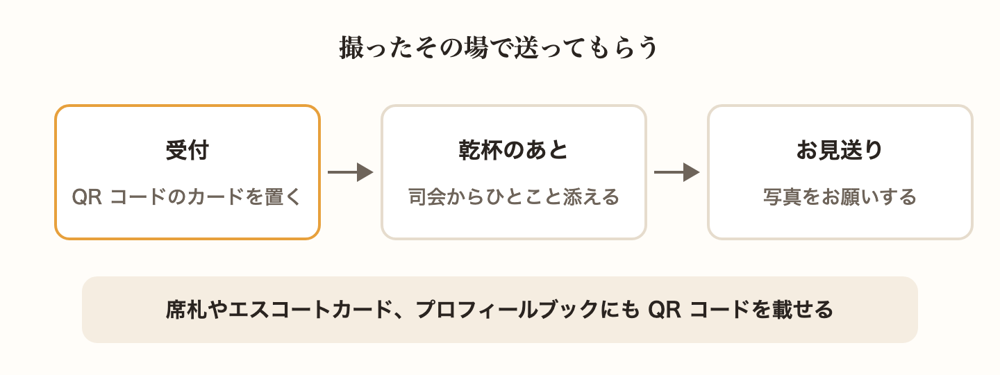
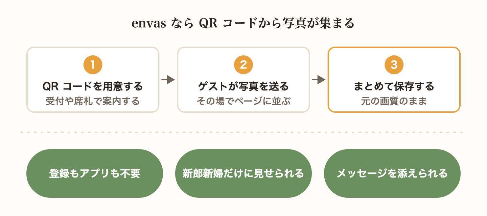

結婚式の当日、ゲストはたくさんの写真をスマートフォンで撮ってくれます。けれど、その写真がおふたりの手元に届くのは一部だけ、ということも少なくありません。「あとで送るね」と言ってもらったまま、どこにあるのかわからなくなってしまうこともあります。

この記事では、ゲストが撮った写真を集める主な方法と向き不向き、集める前に決めておきたいこと、当日の案内のしかたを紹介します。

## ゲストの写真はおふたりが見られなかった当日の記録

プロのカメラマンは、入場や誓いの場面、ケーキ入刀のような式の流れを、おふたりを主役にして撮ってくれます。一方で、ゲストの写真には、ゲストの席から見た景色や、テーブルで笑い合うゲストどうしの姿など、カメラマンの写真には残りにくい場面が写っています。

当日のおふたりは、高砂の席やお色直しで、会場のすべてを見ることはできません。ゲストの写真を集めると、自分たちが見られなかった時間まで振り返れるようになります。

## 写真を集める主な方法と向き不向き

ゲストの写真を集める方法は、いくつかあります。どれが正しいということはないので、ゲストの顔ぶれと、おふたりがどこまで手間をかけられるかで選びましょう。

- 写真の共有アルバムのサービスを使う方法。ゲストが同じアルバムに写真を足していけます。写真を足すには、アカウントへのログインやアプリが要ることが多いので、ゲストにとって慣れたサービスかどうかが分かれ目になります
- LINE のアルバムを使う方法。多くの方が使い慣れているのが強みです。そのかわり、ゲストに同じグループに入ってもらう必要があり、親族や職場の方まで含めると、グループを作るだけでひと手間かかります
- AirDrop で受け取る方法。その場で送ってもらえますが、近くにいる iPhone どうしに限られます。当日のおふたりは忙しいので、受け取る役を友人にお願いしておくと安心です
- 後日メールやメッセージで送ってもらう方法。ゲストの準備は要りませんが、送るのを忘れてしまう方も多く、集め漏れが出やすくなります

どの方法でも、サービスや送り方によっては写真が小さく縮められて届くことがあります。印刷やアルバム作りに使いたいなら、元の画質のまま届くかどうかも確かめておきましょう。

## 集める前に決めておきたいこと

方法を選んだら、ゲストに案内する前に、次のことを決めておくと集めやすくなります。

- 写真を送ってもらう場所。案内する場所はひとつにまとめると、ゲストが迷いません
- いつまでに送ってもらうか。当日のうちに、または 1 週間以内のように目安を伝えると、後回しにされにくくなります
- 画質。元の画質で残したいなら、元の画質のまま届く方法を選びます
- 写真を誰に見せるか。送られた写真をゲストどうしで見られるようにするか、おふたりだけが見るかを決めます

見せる範囲は、意外と大切です。ゲストの中には、自分の写りが気になる方や、お子さんの写真を広く見せたくない方もいます。ゲストが見せる相手を選べるようにしておくと、気兼ねなく送ってもらえます。

## 当日の案内は QR コードでその場で送ってもらう

写真は、撮ったその場で送ってもらうのがいちばん確実です。時間がたつほど、ゲストのスマートフォンの中でほかの写真に埋もれていきます。

送り先の URL は、QR コードにしてゲストの目に入る場所に置きましょう。

- 受付や会場の入口に、QR コードを印刷したカードを置く
- 席札やエスコートカード、プロフィールブックに QR コードを載せておく
- 乾杯のあとなどに、司会の方から「写真はこちらへ」とひとこと添えてもらう
- お見送りのときにも声をかける

## envas の写真共有なら QR コードから集められる

envas の写真共有なら、おふたりは QR コードを 1 枚用意するだけです。ゲストは QR コードか URL からページを開き、撮った写真を選んで送るだけで、会員登録もアプリのインストールも要りません。送られた写真はその場でページに並び、ゲストどうしで見られます。

写真は元の画質のまま届き、おふたりは 1 枚ずつでも、まとめてでも保存できます。

- ゲストは写真を送るときに、みんなに見せるか、新郎新婦だけに見せるかを選べます
- 写真を送るページに、来てくれたお礼や撮ってほしい場面のお願いなど、おふたりからのメッセージを添えられます
- 公開中のプロフィールブックと席次表にも「写真を送る」の入口が出るので、プロフィールブックを見ているゲストもそのまま写真を送れます
- 購入する前でも、ゲストが送りやすいように、おふたりの写真を先にページに並べておけます
- 載せたくない写真は、ゲストから隠したり、消したりできます

写真共有は、基本利用料とは別のご購入です。使い方は、ヘルプページで紹介しています。

[https://help.envas.jp/guest-photo-sharing/](https://help.envas.jp/guest-photo-sharing/)

席次表も QR コードでゲストのスマートフォンに届けたいときは、紙と WEB の席次表を比べたこちらの記事も参考にしてください。

[席次表は紙と WEB のどちらにする？手作り、業者、WEB の違いを比べてみました](/articles/2026-10-07-paper-vs-web-seating-chart/)
