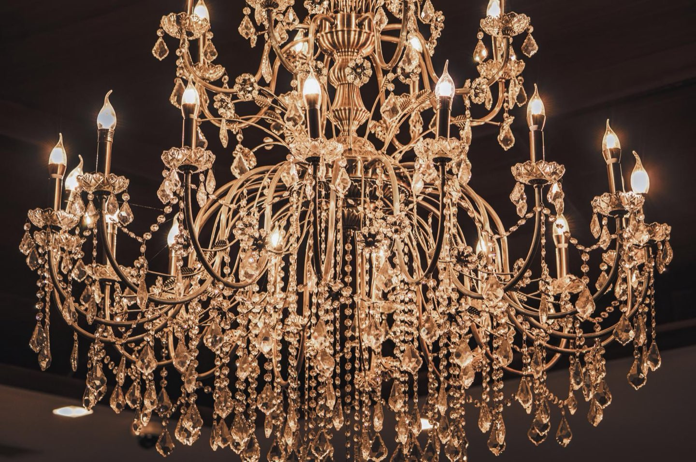
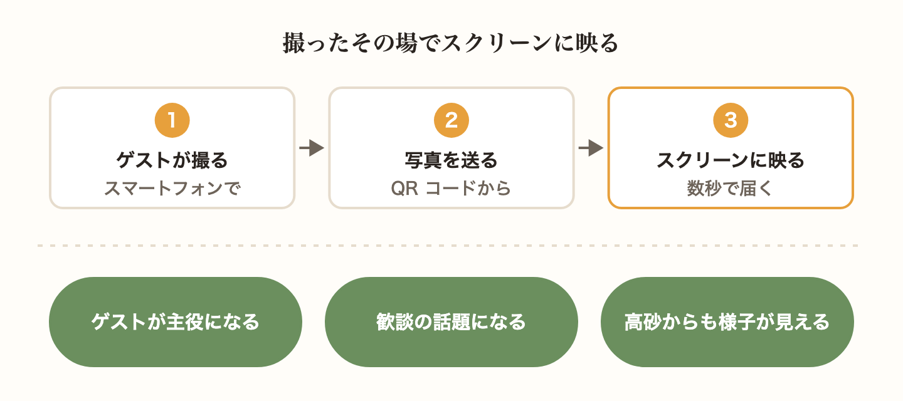
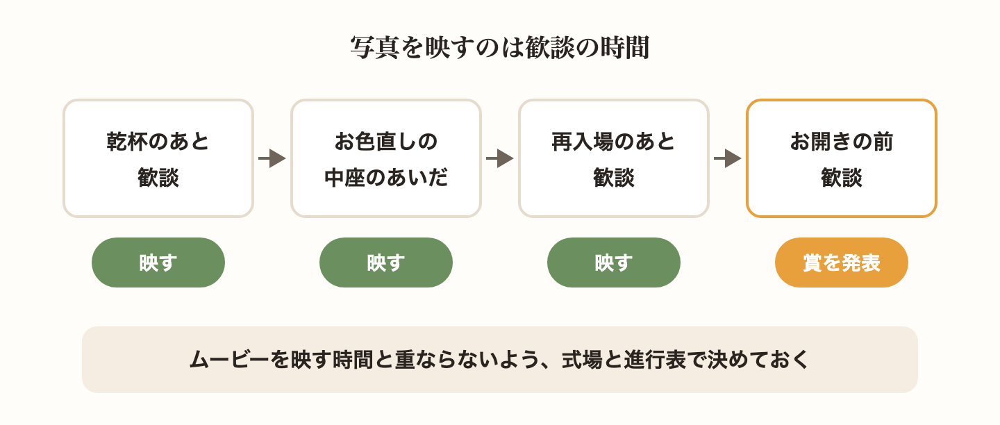
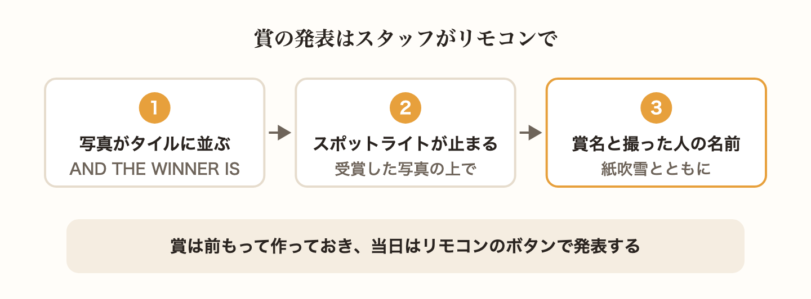
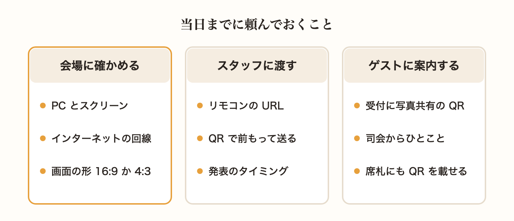
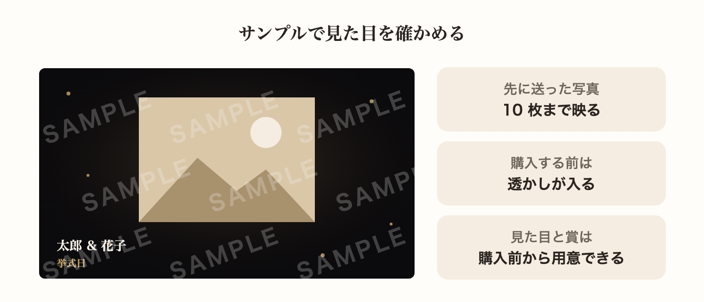
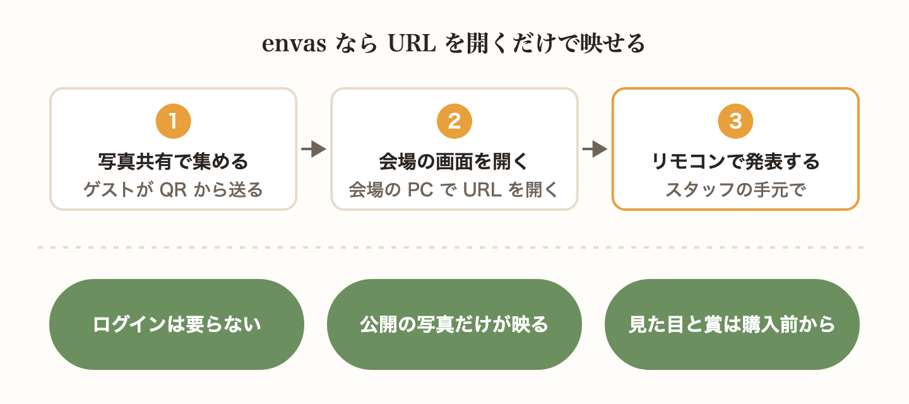

披露宴のあいだ、ゲストはスマートフォンでたくさんの写真を撮ってくれます。その写真を、撮ったその場で会場のスクリーンに映せたら、ゲストにとってもおふたりにとっても、心に残る時間になります。

この記事では、ゲストの写真をスクリーンに映す演出のよさと、映す時間の決め方、当日までに会場やスタッフと準備しておくこと、賞の発表の使い方を、envas のスライドショーでの手順とあわせて紹介します。

## ゲストの写真がその場で映る参加型の演出

ムービーや余興は、おふたりや友人が前もって用意して、ゲストに見てもらう演出です。ゲストの写真のスライドショーは、ゲスト自身が撮った写真で少しずつできあがっていく、参加型の演出です。

自分が撮った写真がスクリーンに映ると、ゲストは思わず周りの人に教えたくなります。「いまの写真、誰が撮ったの」と、テーブルをこえて会話が生まれることもあります。写真を送る人が増えるほどスクリーンに映る写真も増えていくので、会場のみんなで披露宴を作っているような雰囲気になります。

おふたりにとっても、うれしい演出です。高砂の席からは、ゲストのテーブルの様子までは見えません。スクリーンに映る写真で、ゲストがどんなふうに楽しんでくれているかを、その場で知ることができます。

## 映す時間を決めておく

ゲストの写真を映すのに向いているのは、ゲストが席で食事や会話を楽しんでいる時間です。

- 乾杯のあとの歓談の時間
- お色直しの中座のあいだ
- 再入場のあとの歓談の時間

お色直しの中座のあいだは、おふたりが会場にいないぶん、スクリーンがゲストの目を引きます。中座の前に、司会の方から「写真を送ると、スクリーンに映ります」とひとこと添えてもらうと、写真を送ってくれる方が増えます。

会場のスクリーンでは、オープニングムービーやプロフィールムービーも映します。どの時間にどの映像を映すかを式場の担当の方と相談して、進行表に書いておきましょう。歓談の時間はずっと写真を映しておき、ムービーの時間だけ映像を替えてもらう、という形もあります。

披露宴だけでなく、二次会でも同じように映せます。

## 賞の発表で会場を盛り上げる

写真を映すだけでなく、届いた写真の中から賞を選んで発表すると、会場がもうひと盛り上がりします。「ベストショット賞」「いちばんの笑顔で賞」「新郎新婦のお気に入り賞」のように、おふたりらしい賞を考えてみましょう。

envas のスライドショーでは、賞を作って写真を 1 枚選んでおくと、当日スタッフが手元のリモコンから会場の画面で発表できます。発表は次の順に進みます。

- 届いた写真が画面いっぱいのタイルに並び、「AND THE WINNER IS」の文字が出る
- スポットライトがタイルの上を動き、受賞した写真で止まる
- 受賞した写真が大きく映り、紙吹雪とともに賞名と説明が出る
- 最後に、写真を送ったゲストの名前が出る

写真を送ったゲストの名前が出るのは、この発表のときだけです。通常のスライドショーでは名前は出ないので、ゲストは気兼ねなく写真を送れます。

賞名と説明は、前もって作っておけます。写真は、届いた写真の中から管理画面で選びます。披露宴の写真で発表したいときは、お色直しの中座のあいだなど、写真を選ぶ時間を進行の中に取っておきましょう。賞に選べるのは、みんなに公開されている写真だけです。

発表は、お開きの前の歓談の時間がおすすめです。写真がいちばん集まっていて、それまでに映った写真を思い出しながら楽しんでもらえます。発表のあとは、スタッフがリモコンでスライドショーを選ぶと、写真を順に映す画面になります。

賞の作り方は、ヘルプページで紹介しています。

[https://help.envas.jp/guest-photo-slideshow/#awards](https://help.envas.jp/guest-photo-slideshow/#awards)

## 当日までに会場とスタッフに頼んでおくこと

スライドショーは、会場の PC でウェブページを開いて、スクリーンに映します。式場によって機材や回線の事情が違うので、打ち合わせのときに次のことを確かめておきましょう。

- 会場の PC か、持ち込んだ PC で、ウェブページをスクリーンに映せるか
- その PC がインターネットにつながるか。会場の Wi-Fi を使えるか
- スクリーンの形が横長の 16:9 か、少し四角い 4:3 か

ゲストも写真を送るときにインターネットを使います。電波の入りにくい会場もあるので、ゲストが会場の Wi-Fi を使えるかどうかも聞いておくと安心です。できれば前もって、会場の機材で一度ページを開かせてもらいましょう。

当日の進行は、式場のスタッフや司会の方、信頼できる友人にお願いします。おふたりは高砂の席にいるので、会場の PC に触れなくても進められるようにしておきます。envas のスライドショーは、会場の PC で開く「会場の画面」と、スタッフがスマートフォンで開く「リモコン」の 2 つの URL に分かれています。リモコンの URL は QR コードにして保存できるので、進行をお願いする方に前もって送り、どのタイミングで賞を発表するかも伝えておきましょう。URL は作り直せるので、送る相手を間違えたときも前の URL を使えなくできます。

ゲストへの案内も忘れずに。写真が届かなければ、スクリーンに映るものもありません。受付に写真共有の QR コードを置き、乾杯のあとなどに司会の方から「写真はこちらから送れます。送った写真はスクリーンに映ります」とひとこと添えてもらいましょう。席札やエスコートカードに QR コードを載せておくのもおすすめです。

会場での準備は、ヘルプページでも紹介しています。

[https://help.envas.jp/guest-photo-slideshow/#venue](https://help.envas.jp/guest-photo-slideshow/#venue)

## サンプルで見た目を前もって確かめる

当日どう映るかは、前もって確かめておきたいものです。envas のスライドショーでは、おふたりが先に送っておいた写真を使って、会場の画面と同じ見た目のサンプルを開けます。サンプルに映るのは、先に送った写真から 10 枚までです。スライドショーを購入する前でも開け、購入するまでは「SAMPLE」の透かしが入ります。

画面は、黒地の中央に写真がゆっくり動きながら映り、左下におふたりの名前と挙式日が出る、上品な見た目です。画面の形は、会場のスクリーンに合わせて 16:9 と 4:3 から選べます。見た目の選択と賞の準備は、購入する前からできます。

サンプルの開き方は、ヘルプページで紹介しています。

[https://help.envas.jp/guest-photo-slideshow/#sample](https://help.envas.jp/guest-photo-slideshow/#sample)

## envas のスライドショーなら URL を開くだけで映せる

envas のスライドショーは、写真共有でゲストから集めた写真を、会場のスクリーンに映す機能です。会場の画面もリモコンも URL を開くだけで使え、ログインは要りません。

- 写真は 1 枚ずつ 7 秒ほど映り、新しく届いた写真は数秒で、いま映っている写真のすぐあとに映ります
- 映るのは、みんなに公開されている写真だけです。ゲストが新郎新婦だけに見せると選んだ写真や、おふたりが非表示にした写真は映りません
- 映したくない写真は、上映中でも管理画面で非表示にすると、数秒で画面から外れます
- 賞を作っておくと、スタッフがリモコンから発表できます
- 見た目の選択と賞の準備、サンプルの確認は、購入する前からできます

スライドショーは、写真共有とは別のご購入です。ゲストから写真を集める写真共有を先にご購入いただくと、スライドショーを購入できるようになります。使い方は、ヘルプページで紹介しています。

[https://help.envas.jp/guest-photo-slideshow/](https://help.envas.jp/guest-photo-slideshow/)

写真共有の使い方は、こちらのヘルプページで紹介しています。

[https://help.envas.jp/guest-photo-sharing/](https://help.envas.jp/guest-photo-sharing/)

ゲストに写真を送ってもらうための案内のしかたは、こちらの記事も参考にしてください。

[結婚式でゲストが撮った写真を集める方法 共有のしかたと当日の案内のコツ](/articles/2026-10-12-guest-photo-collect/)
