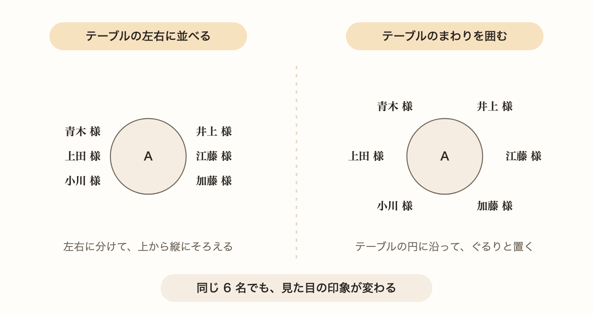
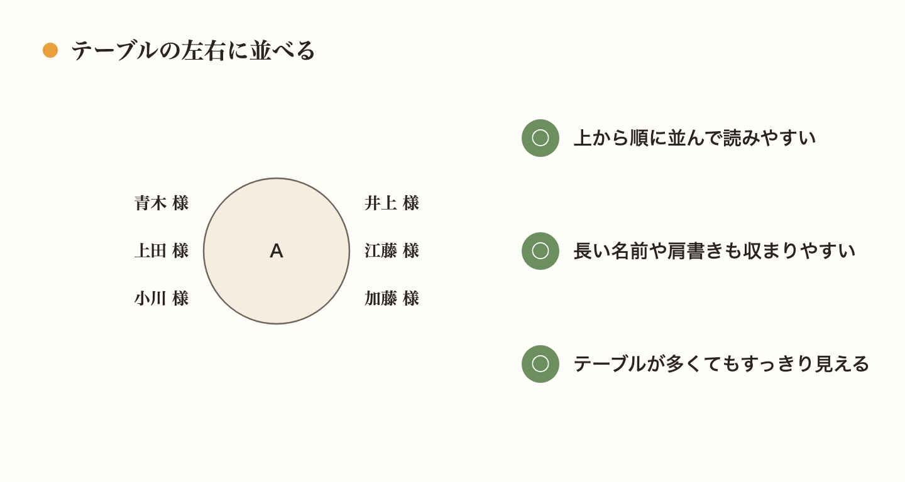
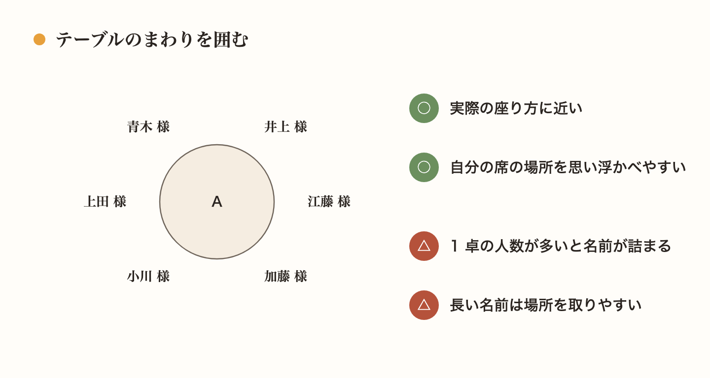
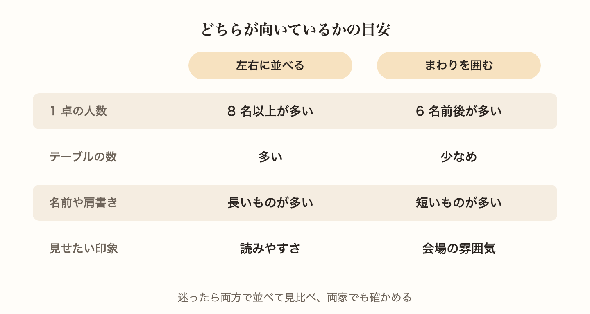
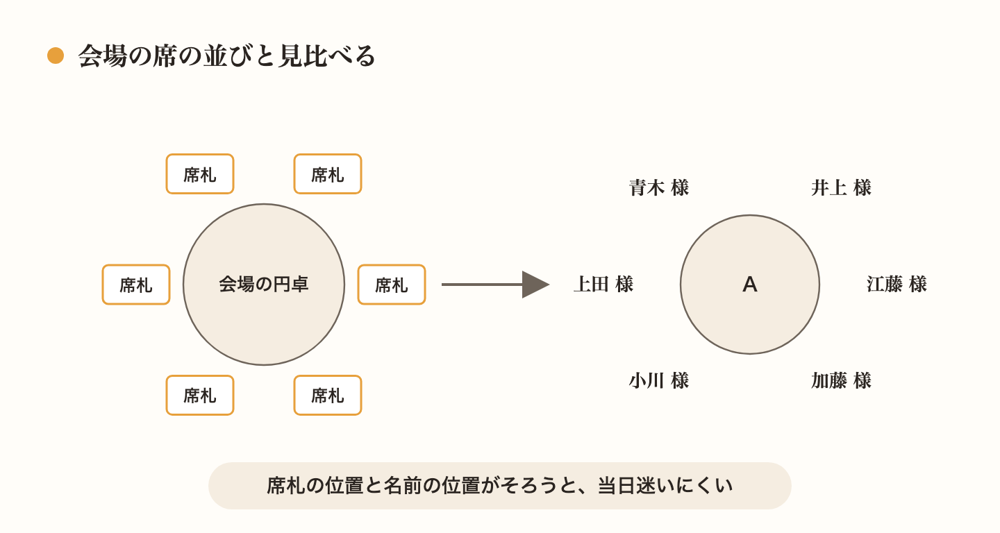
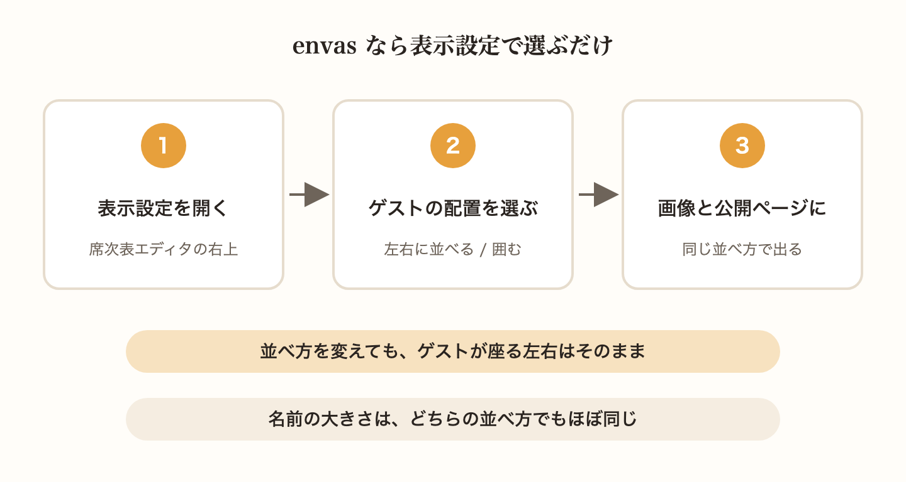

席順が決まって、いよいよ席次表の形にしようという段階で、意外と迷うのが名前の並べ方です。同じテーブルに同じゲストが座っていても、名前の置き方ひとつで席次表の印象はずいぶん変わります。

この記事では、よく使われる 2 つの並べ方と、それぞれが向いている席次表の目安を紹介します。

## 名前の並べ方は大きく 2 通り

テーブルごとのゲストの名前の並べ方は、大きく分けて次の 2 通りです。

- **テーブルの左右に並べる**: テーブルの左右に名前を分け、上から縦にそろえて並べます
- **テーブルのまわりを囲む**: テーブルの円に沿って、まわりを囲むように名前を置きます

どちらが正しいということはありません。席次表全体の見やすさと、おふたりが伝えたい雰囲気に合わせて選びましょう。

## テーブルの左右に並べると読みやすい

左右に並べる形は、印刷の席次表でも昔からよく見かける並べ方です。名前が上から順に並ぶので、ゲストが自分の名前を探しやすいのがいちばんの良さです。

名前を縦にそろえるため、長い名前や肩書きが入っても形が乱れにくく、テーブルの数が多い席次表でもすっきりまとまります。1 卓に 8 名以上座るテーブルが多いときも、名前が窮屈になりにくい並べ方です。

## まわりを囲むと会場の様子が伝わる

まわりを囲む形は、円卓を囲んで座る会場の様子をそのまま写したような並べ方です。ゲストは席次表を見ただけで、テーブルのどのあたりに座るのかを思い浮かべやすくなります。

見た目にも動きが出るので、6 名前後のテーブルが中心の席次表なら、華やかな印象に仕上がります。

一方で、1 卓の人数が多いと、テーブルのまわりに名前が詰まって見えやすくなります。長い名前や肩書きが多いときも、ほかのテーブルの名前との間が狭くなりがちです。

## どちらを選ぶかの目安

迷ったときは、次の 4 つを手がかりにしてみてください。

- **1 卓の人数**: 8 名以上のテーブルが多いなら左右に、6 名前後が多いなら囲む形も選びやすくなります
- **テーブルの数**: テーブルが多い席次表は、左右に並べたほうがすっきりまとまります
- **名前や肩書きの長さ**: 長いものが多いなら、左右に並べたほうが読みやすくなります
- **見せたい印象**: 読みやすさを優先するなら左右に、会場の雰囲気を伝えたいなら囲む形が向いています

それでも決められないときは、実際のゲストの名前で両方を並べて見比べるのがいちばんです。ご両親にも見てもらい、両家で読みやすいと感じたほうを選ぶと安心です。

## 囲む形にするなら会場の席と見比べる

囲む形の席次表は、ゲストが名前の位置を実際の席の位置として受け取りやすい並べ方です。席次表の名前の位置と、会場で席札を置く位置が大きく違うと、当日テーブルに着いてから戸惑うゲストが出るかもしれません。

席札の並べ方は、会場のスタッフと打ち合わせて決めることが多いので、席次表の名前の位置と見比べておきましょう。左右に並べる形でも、左右どちらの側に座るかをそろえておくと、ゲストが席を探しやすくなります。

## envas なら並べ方をあとから選べる

WEB 席次表の envas では、席次表エディタの「表示設定」にある「ゲストの配置」で、「卓の左右に並べる」と「卓を囲む」のどちらかを選べます。

- 選んだ並べ方は、席次表エディタ・ダウンロードする画像・ゲストに見てもらう公開ページのすべてに使われます
- 並べ方を変えても、ゲストがテーブルの左右どちらに座るかは変わりません。配席をやり直す必要はありません
- 「卓を囲む」でも、名前は「卓の左右に並べる」とほぼ同じ大きさで表示されます

配席を終えてから両方を見比べ、気に入ったほうを選べます。下の図は、ゲスト 60 名・8 卓の席次表を「卓を囲む」で表示した例です。

並べ方の選び方は、ヘルプページで紹介しています。

[https://help.envas.jp/seating-chart/#guest-arrangement](https://help.envas.jp/seating-chart/#guest-arrangement)

名前を並べる前の、席順の決め方はこちらの記事にまとめています。

[結婚式の席順はどう決める？上座と下座の基本とテーブル分けのコツ](/articles/2026-10-07-seating-order/)
