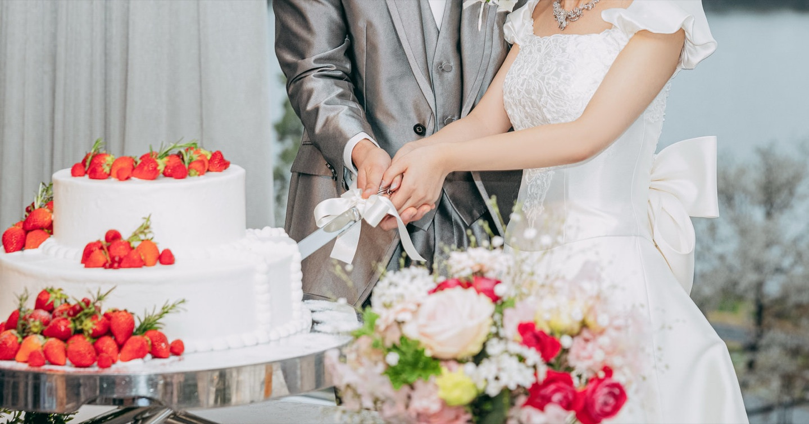
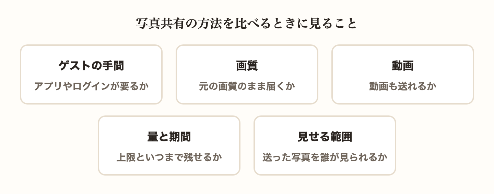
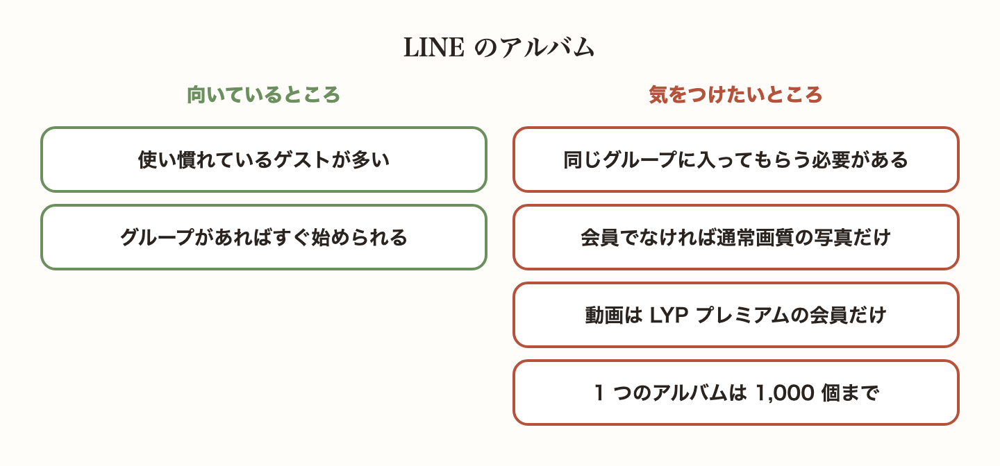
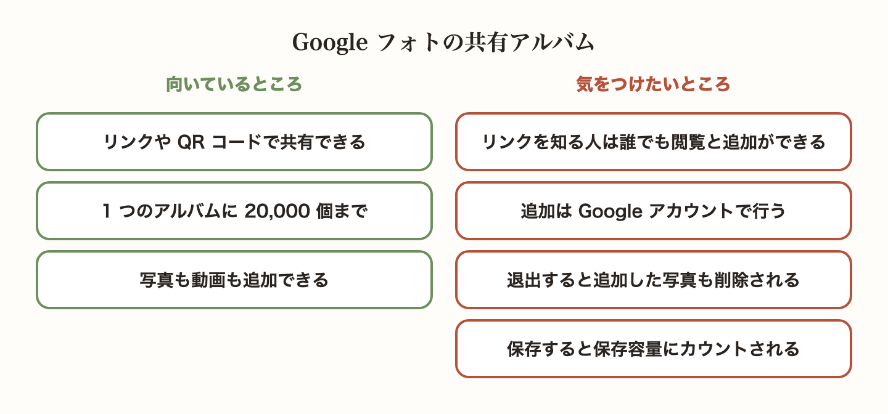
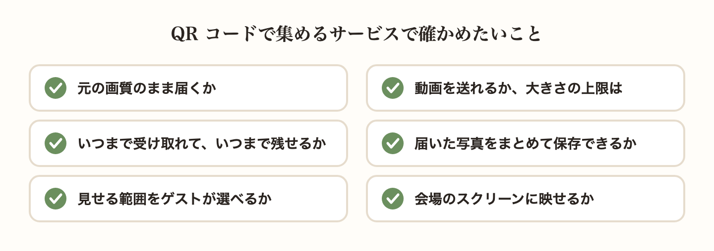
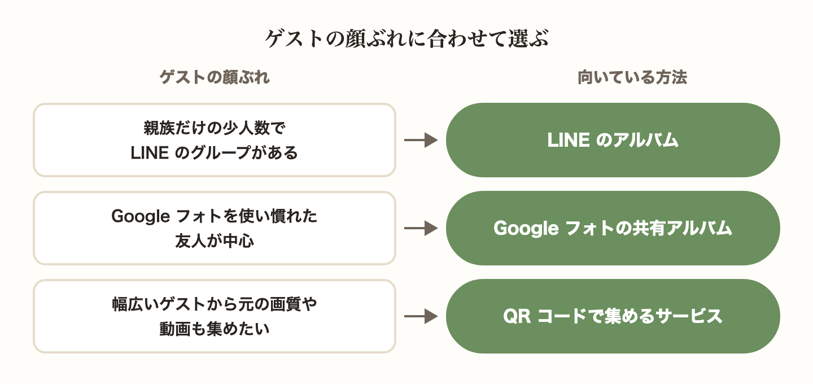
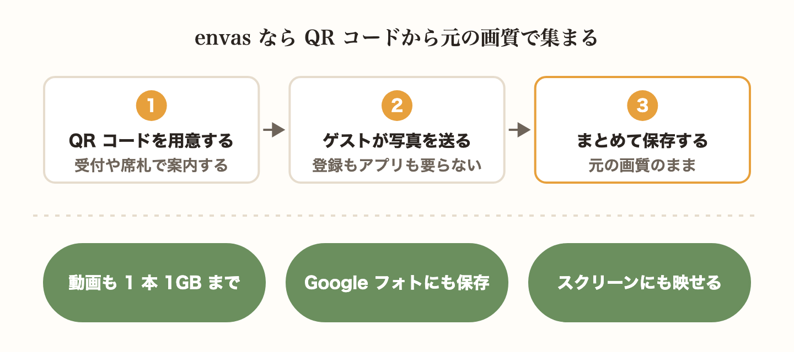

ケーキ入刀や乾杯の場面では、ゲストがいっせいにスマートフォンを向けてくれます。その写真をどうやって受け取るかは、結婚式の準備のなかで意外と迷うところです。LINE のアルバムで足りるのか、Google フォトの共有アルバムがいいのか、QR コードで集める写真共有のサービスを使うのか、調べるほど選択肢が増えていきます。

この記事では、結婚式の写真共有によく使われる 3 つの方法を、ゲストの手間、画質、動画、集められる量の点から比べます。どれが正しいということはないので、ゲストの顔ぶれに合う方法を選ぶための材料にしてください。

ゲストへの当日の案内のしかたは、こちらの記事で紹介しています。

[結婚式でゲストが撮った写真を集める方法 共有のしかたと当日の案内のコツ](/articles/2026-10-12-guest-photo-collect/)

## 写真共有の方法を比べるときに見ること

方法ごとの違いは、次の点に表れます。

- ゲストの手間。アプリのインストールやアカウントへのログイン、グループへの参加が要るかどうかで、写真を送ってくれる人の数が変わります
- 画質。印刷やアルバム作りに使うなら、元の画質のまま届くかどうかが大切です
- 動画。乾杯の発声や余興は、動画で撮るゲストも多い場面です
- 集められる量と残せる期間。ゲストの多い結婚式では、1 つのアルバムに入る数の上限に届くこともあります
- 見せる範囲。送った写真がゲスト全員に見えるのか、おふたりだけが見るのかを考えておきます

## LINE のアルバムは使い慣れたゲストが多い

LINE のアルバムは、多くのゲストが使い慣れているのがいちばんの強みです。親族のグループトークがすでにあるなら、そこにアルバムを作るだけで始められます。

一方で、アルバムを作れるのは 1 対 1 のトークかグループのトークです。ゲストに写真を足してもらうには、同じグループに入ってもらう必要があります。職場の方や友人まで含めると、グループを作って招待するだけでひと手間かかります。

画質と動画にも、気をつけたい点があります。LINE のヘルプによると、LYP プレミアムの会員でない人がアルバムに追加できるのは、通常画質の写真だけです。オリジナル画質の写真と動画を追加できるのは、LYP プレミアムの会員に限られます。

アルバムに入れられる量にも上限があります。

- 1 つのトークルームで作れるアルバムは 100 個まで
- 1 つのアルバムに保存できるのは 1,000 個まで。写真なら 1,000 枚に当たります
- 1 回でアップロードできるのは 300 個まで
- 1 か月にアップロードできる量にも上限があります

親族だけの少人数の結婚式や、ゲストどうしがすでにグループでつながっている場合に向いた方法です。

## Google フォトの共有アルバムはリンクと QR コードで集められる

Google フォトの共有アルバムは、アルバムへのリンクを送るだけで共有できます。アルバムの QR コードも作れるので、受付に置いておけば、ゲストはその場でアルバムを開けます。アルバムを見た人は、自分の写真や動画を追加できます。1 つのアルバムには 20,000 個まで写真や動画を入れられるので、ゲストの多い結婚式でも量の心配はほとんどありません。

気をつけたいのは、リンクの扱いです。Google フォトのヘルプによると、アルバムへのリンクを共有すると、リンクを知っている人は誰でも写真を見たり、アルバムに写真を追加したりできるようになります。リンクが思わぬところに広まってしまったときは、リンクの共有をいったんオフにしてからオンにし直すと、古いリンクは使えなくなります。

アルバムに写真を追加すると、追加した人の Google アカウントのプロフィール写真やイニシャルが、写真の横に表示されます。写真を足すゲストは Google アカウントを使うことになるので、ふだん Google フォトを使っているゲストにはなじみやすく、使っていないゲストにはひと手間になります。

また、ゲストが共有アルバムから退出すると、そのゲストが追加した写真や動画、コメントもすべて削除されます。残しておきたい写真は、早めにおふたりのライブラリに保存しておきましょう。

共有アルバムの写真をおふたりのライブラリに保存すると、そのぶんは Google アカウントの保存容量にカウントされます。保存容量は Gmail、Google ドライブ、Google フォトで共有していて、無料で使えるのは 15 GB までです。ゲストの動画をたくさん保存するなら、空き容量も確かめておきましょう。

## QR コードで集める写真共有のサービスはゲストの準備が少ない

結婚式の写真集めのために作られたサービスもあります。多くは、ゲストが QR コードを読み取ると、スマートフォンのブラウザで写真を送るページが開く仕組みです。アプリのインストールやアカウントの登録が要らないものが多く、ゲストの顔ぶれを選ばずに使いやすいのが強みです。

無料のものも有料のものもあり、披露宴の会場のスクリーンに写真を映せるものまで、サービスによって中身はさまざまです。選ぶときは、次の点を確かめておきましょう。

- 写真が元の画質のまま届くか
- 動画を送れるか。1 本の大きさに上限があるか
- いつまで写真を受け取れて、いつまで残しておけるか
- 届いた写真をまとめて保存できるか
- 送った写真を誰に見せるか、ゲストが選べるか
- 披露宴の会場のスクリーンに映せるか

受け取れる期間や残しておける期間が決まっているサービスもあります。いつまでに保存すればよいかを、使い始める前に確かめておくと安心です。

## ゲストの顔ぶれに合わせて選ぶ

3 つの方法の向き不向きを、ゲストの顔ぶれで整理すると次のようになります。

- 親族だけの少人数で、すでに LINE のグループがあるなら、LINE のアルバムで手軽に始められます
- ふだん Google フォトを使う友人が中心なら、Google フォトの共有アルバムが使いやすいでしょう。リンクを送る相手には気を配ります
- 職場の方や年配の方まで幅広いゲストから集めたいとき、元の画質や動画も残したいとき、披露宴で写真を共有して会場のスクリーンに映したいときは、QR コードで集めるサービスが向いています

どの方法を選んでも、ゲストに案内する送り先はひとつにまとめましょう。送り先が分かれると、ゲストが迷ってしまい、おふたりも写真を探しにくくなります。

## envas の写真共有なら元の画質で集めて Google フォトにも保存できる

envas の写真共有は、QR コードで集める型のサービスです。おふたりはゲストに配る QR コードと URL を受け取り、受付や席札で案内します。ゲストは QR コードを読み取って写真を選ぶだけで、アプリのインストールも会員登録も要りません。

- 写真は元の画質のまま届き、おふたりは 1 枚ずつでも、まとめてでも保存できます
- 写真は JPEG・PNG・WebP、動画は MP4 と MOV を送れます。写真は 1 枚 30MB、動画は 1 本 1GB までで、挙式全体では写真と動画を合わせて 30GB まで受け取れます
- 届いた写真と動画は、マイページからボタンひとつで、おふたりの Google フォトか Google ドライブへ元の画質のまま送れます。Google の許可は保存のたびにおふたりのブラウザで求め、envas が預かることはありません
- ゲストは写真を送るときに、みんなに見せるか、新郎新婦だけに見せるかを選べます
- 写真を受け取れるのは、データの保管期限までです。保管期限は挙式日から 90 日間で、データ保管期間延長で 1 年ずつ延ばせます
- 購入する前でも、ゲストが送りやすいように、おふたりの写真を先にページに並べておけます

写真共有は 1,980円（税込）です。スライドショーを合わせて購入すると、届いた写真を披露宴の会場のスクリーンに映せます。スライドショーは 4,800円（税込）で、写真共有のご購入が前提です。使い方は、ヘルプページで紹介しています。

[https://help.envas.jp/guest-photo-sharing/](https://help.envas.jp/guest-photo-sharing/)

届いた写真を会場に映す演出は、こちらの記事で紹介しています。

[披露宴でゲストの写真をスクリーンに映すスライドショー 当日の準備と賞の発表のコツ](/articles/2026-10-13-guest-photo-slideshow/)

Google フォト、Google ドライブは Google LLC の商標です。
